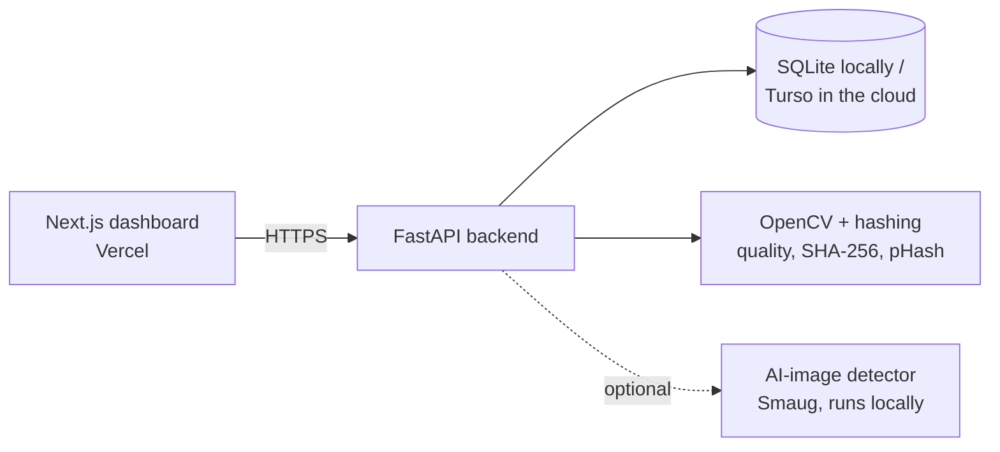

# VoterGuard

**An open prototype that helps authorised reviewers screen voter-registration photos and records for possible irregularities, with humans making every decision.**

> **Prototype notice.** VoterGuard is an independent, experimental project built on **synthetic data**.
> It is **not** endorsed by, affiliated with, or connected to INEC or any electoral body, and it does **not** access any voter register.
> It never declares fraud. Every flag is a signal that needs human review.

Live demo (frontend): https://voterguard.vercel.app

## What it does

| Capability | Status |
|---|---|
| Image upload and validation (type, size, safe decoding) | Working, automated tests |
| Image quality checks (OpenCV), SHA-256, perceptual hash, metadata presence | Working, automated tests |
| Duplicate-photo screening against a reference collection | Working, automated tests |
| Human review of match candidates (confirmed / not duplicate / needs more info) | Working, automated tests |
| Audit log and dashboard statistics | Working, automated tests |
| AI-generated image screening (Smaug-AI-Image-Detector) | **Experimental**, accuracy on registration-style photos not yet measured |
| Cloud database (Turso) | In progress, not yet verified |
| Public hosted API | In progress |
| Authentication and roles, offline desktop app, registration-record rules | Planned |

## How it works



- `app/`, `components/`, `lib/`: the dashboard (Next.js, React, TypeScript)
- `backend/`: the API, tests and Docker setup. See [`backend/README.md`](backend/README.md) for run instructions and the API list

## Run the backend locally

```bash
cd backend
python -m venv .venv && source .venv/bin/activate
pip install -r requirements.txt
python -m pytest -q
uvicorn app.main:app --reload --port 8000
```

## Limits you should know

- **Similarity is not identity.** Perceptual hashing finds visually similar images. It is not facial recognition and does not show two photos are the same person.
- **AI detection is probabilistic.** It can miss new generators and wrongly flag real photos. Its published benchmarks are not results on voter-registration photos.
- **Local data only.** Matching only covers images loaded into the local reference collection.
- **Not production-grade.** No authentication yet, and no independent security assessment. Do not use real voter data.
- **Free hosting limits.** Free tiers sleep when idle and may reset local storage.

## Privacy and responsible use

Use synthetic photos and fictitious records only. Do not upload real voter data, biometrics or identifiable citizen images to this prototype. Any real pilot would first need written authorisation, a lawful purpose, a privacy and security assessment, and human review before any action is taken.

## Roadmap

1. Verified cloud persistence and a public demo API
2. Measured accuracy of the AI detector on licensed sample sets
3. Role-based access and a fuller review and case workflow
4. Offline desktop version (Tauri) for low-connectivity settings

## Contact

Project contact: oluwasedidunisrael2010@gmail.com

## License

MIT. See [`LICENSE`](LICENSE). The optional AI model is separately licensed by its authors (Smaug-AI-Image-Detector, Apache-2.0).
